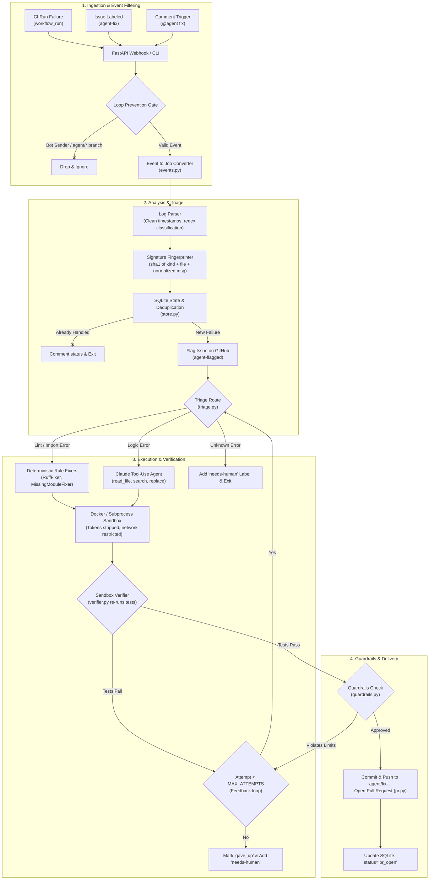
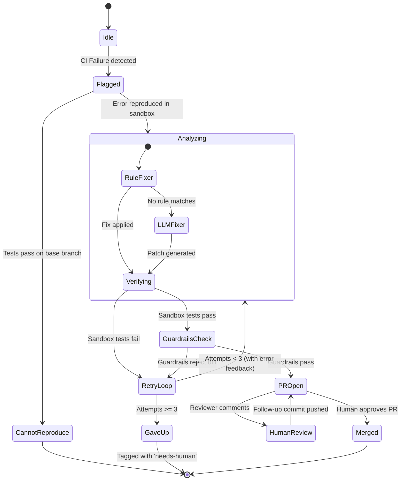

# 🤖 Junior Engineer Bot

<div align="center">


**An autonomous AI engineering agent that monitors GitHub CI failures, isolates bugs in a sandbox, fixes them with deterministic rules or Claude tool-use, enforces strict guardrails, and opens verified Pull Requests.**

[Overview](#-overview) • [System Architecture](#-system-architecture) • [End-to-End Workflow](#-end-to-end-workflow-diagram) • [Quick Start](#-how-to-run) • [Safety Guardrails](#-safety-guardrails) • [CLI Reference](#-cli-reference)

</div>

---

## 📌 Overview

**Junior Engineer Bot** acts as an automated software engineer on your team. Triggered by GitHub CI failure webhooks, issue labels (`agent-fix`), or comments (`@agent fix`), it:

1. **Ingests & Normalizes CI Logs**: Cleans noisy timestamps and extracts structured failure records (`lint`, `type`, `import`, `test`, `runtime`).
2. **Fingerprints Error Signatures**: Hashes failure signatures while stripping volatile memory addresses (e.g. `0x7ffee...`) and process numbers so identical bugs never produce duplicate issues.
3. **Reproduces in Zero-Trust Sandboxes**: Clones the codebase into an isolated Docker container with memory caps, network restrictions, and authentication tokens stripped from `.git/config`.
4. **Applies Tiered Fixers**: Resolves common issues (formatting, missing dependencies) instantly with zero-cost deterministic rule fixers before falling back to Claude 3.5 Sonnet tool-use.
5. **Verifies in Sandbox**: Re-runs tests to prove the fix actually resolves the failure.
6. **Enforces Strict Guardrails**: Rejects diffs that delete tests (`- def test_...`), skip tests (`@pytest.mark.skip`), exceed file/line caps, or touch protected paths (`.github/`, `auth/`, `.env`).
7. **Opens a Human-Reviewed PR**: Opens a clean Pull Request explaining *What broke*, *What changed*, and *How it was tested*. Human review comments on the PR automatically trigger follow-up commits on the same branch.

---

## 🏗️ System Architecture



---

## 🔄 End-to-End Workflow Diagram

```mermaid
sequenceDiagram
    autonumber
    actor Developer as Team / Reviewer
    participant GH as GitHub CI / API
    participant Agent as Junior Engineer Bot
    participant Box as Isolated Sandbox
    participant LLM as Claude 3.5 Sonnet

    GH->>Agent: Webhook (CI failed on 'main')
    Agent->>GH: Verify HMAC signature & ACK (200 OK)
    Agent->>GH: Fetch CI log zip in-memory
    Agent->>Agent: Parse failure (kind, file, line, excerpt)
    Agent->>Agent: Fingerprint signature (normalize addresses & numbers)
    Agent->>GH: Create tracking issue (#42 [agent] fix...)
    Agent->>Box: Clone repo & scrub tokens from .git/config
    Agent->>Box: Attempt local reproduction
    
    alt Reproducible Failure
        alt Route: Deterministic Rule (Lint / Missing module)
            Agent->>Box: Apply rule fixer (e.g. append package to requirements.txt)
        else Route: Logic Bug (Claude Fallback)
            loop Tool-Use Loop (Max 12 steps)
                Agent->>LLM: Prompt with error excerpt + tools
                LLM->>Agent: Call tool (read_file / search / replace)
                Agent->>Box: Execute sandboxed tool & return data
            end
        end

        Agent->>Box: Verifier re-runs tests
        Box-->>Agent: Tests pass (returncode 0)
        Agent->>Agent: Guardrails validation (diff size, no test deletion)
        Agent->>GH: Push branch 'agent/fix-a1b2c3d4' & Open PR
        Agent->>GH: Post comment closing Issue #42
    else Flaky or Already Fixed
        Agent->>GH: Comment 'Checks pass now; cannot reproduce'
    end

    opt Human Review Loop
        Developer->>GH: Add review comment on PR ("change X to Y")
        GH->>Agent: Webhook (pull_request_review_comment)
        Agent->>Box: Clone PR branch
        Agent->>LLM: Address reviewer feedback
        Agent->>Box: Verify & Guardrails
        Agent->>GH: Push follow-up commit to existing PR branch
    end
```

---

## 🚦 State Machine Lifecycle



---

## 🛡️ Safety Guardrails

Every proposed patch must pass through [`app/guardrails.py`](app/guardrails.py) before any Pull Request is created. The agent rejects fixes that attempt shortcut solutions:

| Safety Gate | Limit / Rule | Why It Exists |
|---|---|---|
| **Max Files** | `MAX_FILES = 5` | Prevents broad, uncontrolled codebase refactoring. |
| **Max Diff Size** | `MAX_LINES = 150` | Enforces small, reviewable, surgical changes. |
| **Max Retries** | `MAX_ATTEMPTS = 3` | Prevents infinite retry loops on intractable bugs. |
| **LLM Step Cap** | `MAX_LLM_STEPS = 12` | Hard-stops tool execution to prevent run-away API spend. |
| **Protected Paths** | `.github/`, `migrations/`, `infra/`, `auth/`, `.env` | Blocks the bot from touching security-critical infrastructure. |
| **No Test Deletions** | `l.startswith('-') and 'def test_'` | Rejects patches that "fix" builds by deleting tests. |
| **No Test Skipping** | `'+' and ('skip' in l or 'xfail' in l)` | Rejects silencing errors via `@pytest.mark.skip` or `xfail`. |
| **Token Scrubbing** | Stripped from `.git/config` | Prevents code in cloned repos from exfiltrating git credentials. |

---

## 🚀 How to Run

### 🌟 Way 1: Zero-Server GitHub Actions (Simplest!)
No server to host, no ports to open, and no private keys to generate. 

Just copy the workflow template from [`workflows/agent-fix.yml`](workflows/agent-fix.yml) into your repository's `.github/workflows/` directory.

Whenever a test or CI build fails on GitHub, GitHub Actions runs the Junior Engineer automatically in the cloud, diagnoses the error, writes a fix, and opens a Pull Request!

---

### 🔑 Way 2: Single-Token CLI Runner
No need for a complex GitHub App setup. Use a standard GitHub Personal Access Token (`ghp_...`):

```bash
export GITHUB_TOKEN="ghp_your_personal_token"
export ANTHROPIC_API_KEY="your_anthropic_api_key"

# Fix any failed CI build on demand:
junior-engineer-bot fix --repo "owner/repo" --run-id 123456789 --branch "main"
```

---

### 💻 Way 3: 100% Offline Local Audit (No GitHub Needed)
Scan any folder or project on your machine for security vulnerabilities, code smells, and missing tests:

```bash
junior-engineer-bot audit /path/to/any/codebase -o AUDIT_REPORT.md
```

---

### 🌐 Way 4: Webhook Server (GitHub App Mode)
Run the 24/7 FastAPI daemon for instant webhook responses:

```bash
export GITHUB_APP_ID="123456"
export GITHUB_PRIVATE_KEY="$(cat key.pem)"
export GITHUB_WEBHOOK_SECRET="your-secret"
export ANTHROPIC_API_KEY="your-key"

junior-engineer-bot serve --host 0.0.0.0 --port 8000
```

Forward webhooks locally with [smee.io](https://smee.io):
```bash
npx smee-client --url https://smee.io/your-channel --target http://localhost:8000/webhook
```

---

## 💻 CLI Reference

```
Usage: junior-engineer-bot [OPTIONS] COMMAND [ARGS]...

  🤖 junior-engineer-bot: Autonomous Junior Engineering Agent for your codebases.

Commands:
  audit  Audit any codebase path for vulnerabilities, bugs, and missing tests.
  fix    Run the automated bug fixer on a failing CI run or issue (serverless mode).
  serve  Start the FastAPI GitHub App webhook listener.
```

### Options:
* `junior-engineer-bot audit [PATH] [-s MIN_SEVERITY] [-o OUTPUT_FILE]`
* `junior-engineer-bot fix --repo REPO --run-id RUN_ID [--branch BRANCH]`
* `junior-engineer-bot serve [--host HOST] [--port PORT] [--reload]`

---

## 🧪 Unit & Integration Tests

The test suite covers log parsing across all failure modes, fingerprint normalization, diff guardrails, and full end-to-end webhook/PR simulation:

```bash
pytest tests -v
```

```
tests/test_end_to_end.py::test_webhook_hmac_verification PASSED          [  4%]
tests/test_end_to_end.py::test_loop_prevention_on_agent_branches PASSED  [  9%]
tests/test_end_to_end.py::test_full_pipeline_end_to_end PASSED           [ 13%]
tests/test_guardrails.py::test_guardrails_rejects_no_changes PASSED      [ 18%]
tests/test_guardrails.py::test_guardrails_rejects_removed_test PASSED    [ 22%]
tests/test_guardrails.py::test_guardrails_rejects_skipped_test PASSED    [ 27%]
tests/test_guardrails.py::test_guardrails_rejects_blocked_path PASSED    [ 31%]
tests/test_guardrails.py::test_guardrails_rejects_too_many_files PASSED  [ 36%]
tests/test_guardrails.py::test_guardrails_rejects_diff_too_large PASSED  [ 40%]
tests/test_guardrails.py::test_guardrails_accepts_clean_valid_fix PASSED [ 45%]
tests/test_log_parser.py::test_parse_import_error PASSED                 [ 50%]
tests/test_log_parser.py::test_parse_lint_error PASSED                   [ 54%]
tests/test_log_parser.py::test_parse_type_error PASSED                   [ 59%]
tests/test_log_parser.py::test_parse_pytest_failure_with_details PASSED  [ 63%]
tests/test_log_parser.py::test_parse_pytest_failure_without_dash PASSED  [ 68%]
tests/test_log_parser.py::test_parse_runtime_error PASSED                [ 72%]
tests/test_log_parser.py::test_parse_unknown_error PASSED                [ 77%]
tests/test_signature.py::test_signature_deterministic PASSED             [ 81%]
tests/test_signature.py::test_signature_normalizes_numbers PASSED        [ 86%]
tests/test_signature.py::test_signature_normalizes_memory_addresses PASSED [ 90%]
tests/test_signature.py::test_signature_differentiates_different_files PASSED [ 95%]
tests/test_signature.py::test_signature_differentiates_different_kinds PASSED [100%]

======================== 22 passed in 1.48s =========================
```

---

## 📁 Repository Layout

```
.
├── app/
│   ├── cli.py               # CLI commands (audit, fix, serve)
│   ├── config.py            # Guardrail thresholds & settings
│   ├── events.py            # Event filtering, trusted roles & loop prevention
│   ├── github_client.py     # GitHub App & GITHUB_TOKEN API client
│   ├── guardrails.py        # Diff inspection safety gate
│   ├── junior_engineer.py   # Pure AST & static vulnerability auditor
│   ├── log_parser.py        # CI log cleaner & failure regex extractor
│   ├── main.py              # FastAPI webhook server
│   ├── orchestrator.py      # End-to-end pipeline orchestrator
│   ├── pr.py                # Git commit, branch management & PR creation
│   ├── sandbox.py           # Docker isolation & subprocess sandbox
│   ├── signature.py         # Error fingerprinting & address normalizer
│   ├── store.py             # SQLite deduplication & state storage
│   ├── triage.py            # Routing engine (rule vs llm vs flag_only)
│   ├── verifier.py          # Reproduction & verification engine
│   └── fixers/
│       ├── base.py          # Fixer interface contract
│       ├── rule_fixers.py   # Deterministic fixers (RuffFixer, MissingModuleFixer)
│       └── llm_fixer.py     # Sandboxed Claude tool-use fallback fixer
├── tests/                   # 22 Unit and End-to-End Integration Tests
├── workflows/               # Serverless GitHub Actions workflow template
├── pyproject.toml           # Package metadata and entry points
├── requirements.txt         # Minimal production dependencies
└── README.md                # Comprehensive documentation
```

---

## 📄 License

MIT License. See [LICENSE](LICENSE) for details.
